<p align="center">
  <a href="https://lokendra-builds.github.io/sheenui/">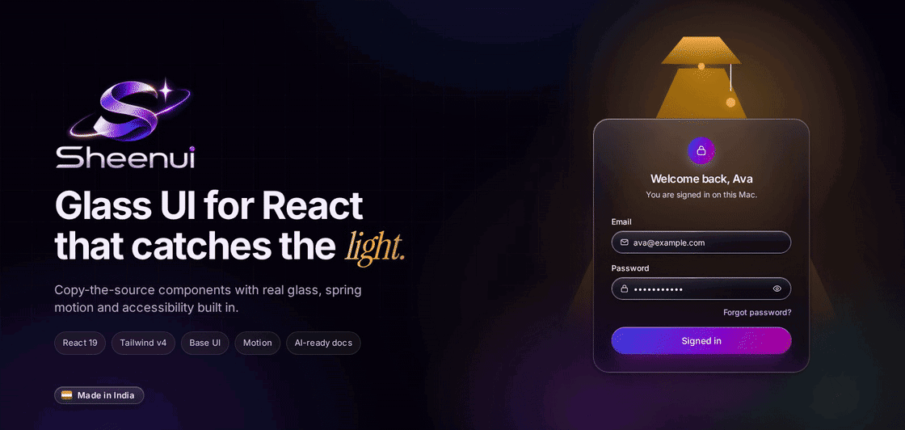</a>
</p>

<h1 align="center">Glassmorphism and Liquid Glass components for React</h1>

<p align="center"><strong>Glass UI that stays readable, with documentation an AI coding agent can build from.</strong><br>Copy-the-source components on Base UI and Tailwind CSS v4, animated with Motion, with a fallback for every blur and a reduced-motion path for every spring.</p>

<p align="center">
  <a href="https://lokendra-builds.github.io/sheenui/"><b>Live demo</b></a> &nbsp;·&nbsp;
  <a href="#built-for-ai-coding-agents">For AI agents</a> &nbsp;·&nbsp;
  <a href="#key-features">Features</a> &nbsp;·&nbsp;
  <a href="https://lokendra-builds.github.io/sheenui/components">Components</a> &nbsp;·&nbsp;
  <a href="https://lokendra-builds.github.io/sheenui/charts">Charts</a> &nbsp;·&nbsp;
  <a href="https://lokendra-builds.github.io/sheenui/blocks">Blocks</a> &nbsp;·&nbsp;
  <a href="#quick-start">Quick start</a>
</p>

```bash
npx shadcn@latest add https://lokendra-builds.github.io/sheenui/r/button.json
```

<p align="center">
  <a href="LICENSE"></a>
  
  
  
  
  
  
  
</p>

<table align="center">
  <tr>
    <td align="center" width="20%"><h3 align="center"><!--n:components-->86<!--/n--></h3><sub>components</sub></td>
    <td align="center" width="20%"><h3 align="center"><!--n:charts-->48<!--/n--></h3><sub>charts</sub></td>
    <td align="center" width="20%"><h3 align="center"><!--n:blocks-->20<!--/n--></h3><sub>blocks</sub></td>
    <td align="center" width="20%"><h3 align="center"><!--n:dashboards-->5<!--/n--></h3><sub>dashboards</sub></td>
    <td align="center" width="20%"><h3 align="center"><!--n:registry-->183<!--/n--></h3><sub>registry items</sub></td>
  </tr>
</table>

<p align="center"><sub>Two style presets, Liquid Glass and Aurora Neon, each in light and dark. Free, MIT, no sign-up. Made in India.</sub></p>

> **Pre-1.0 and not on npm yet.** `@sheenui/theme` is `private` in this repo until the first release. Add components with the shadcn CLI, copy the files, or install a packed tarball from a clone (see [Quick start](#quick-start)).

## Built for AI coding agents

Every export in SheenUI is documented in the source, so a coding agent (Claude Code, Cursor, GitHub Copilot and similar tools) can read what a component does, which props it takes and how to use it, instead of guessing. Nothing here is tuned for one tool: it is plain structure that any agent, or any person, can read.

<p align="center"><a href="https://lokendra-builds.github.io/sheenui/llms.txt">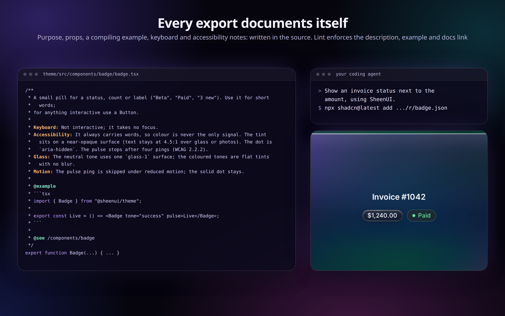</a></p>

- **A doc comment on every export, enforced by lint.** The rule `sheen/require-export-jsdoc` (in [`eslint/sheen-plugin.js`](eslint/sheen-plugin.js)) fails the lint step when an exported component or hook has no JSDoc block with a real description (40 characters or more), an `@example` and an `@see` link to its docs page. Every other exported helper, type and constant needs at least a one-sentence description. The Badge block above is the pattern: purpose, props with their defaults, then Keyboard, Accessibility, Glass and Motion notes.
- **Examples that compile, props that match the code.** `pnpm examples:check` compiles every `@example` as a complete module under `--strict`, and `pnpm docs:check` checks that every public prop is on its page with a description and a default that matches the code.
- **A docs site written for machines too.** [`llms.txt`](https://lokendra-builds.github.io/sheenui/llms.txt) (facts and a page index), [`llms-full.txt`](https://lokendra-builds.github.io/sheenui/llms-full.txt) (a table of contents of the full text), section files under `llms/` such as the [API index](https://lokendra-builds.github.io/sheenui/llms/api-index.txt) (every public export and the page that documents it), and a Markdown twin of every docs page: add `.md` to the page URL.
- **Import paths that match what you installed.** Every code sample on the site and in the `llms` files shows the import you get after `shadcn add` (`@/components/sheenui/<folder>/<file>`), with the `@sheenui/theme` package form beside it as a comment. Start from [`llms.txt`](https://lokendra-builds.github.io/sheenui/llms.txt).
- **One vocabulary across components.** The same prop names recur, so what an agent learns from one component carries to the next: `tone` for status colour, `size`, `variant`, `labels` for every string, `value` / `defaultValue` / `onValueChange` for controlled state, `open` / `onOpenChange` for overlays, `headingLevel` for headings.
- **Exact files, not a guess.** The shadcn registry installs the files a component needs (<!--n:registry-->183<!--/n--> items), and every docs page lists the files and packages to copy, computed from the real import graph. `pnpm copy-test` builds each list in an empty Vite app.

**A prompt to try** in your coding agent:

```text
Add a pricing section with a monthly/yearly toggle using SheenUI.
Read https://lokendra-builds.github.io/sheenui/llms.txt first, then follow the example in each doc comment.
```

The agent would typically run one command and then import from the copied files:

```bash
npx shadcn@latest add https://lokendra-builds.github.io/sheenui/r/pricing.json
```

An agent can still make mistakes. The doc comments and docs pages give it the facts, so review its output like any other change.

## Key features

1. **Glass that stays readable.** Text tokens hold WCAG AA contrast on glass, and a pixel-based check measures it on 20 routes in all four looks. If blur is unavailable or the user asks for less transparency or more contrast, glass becomes a solid surface. [Guide](https://lokendra-builds.github.io/sheenui/guides/accessible-glassmorphism)
2. **Built for AI coding agents.** Every export carries a doc comment, and a lint rule requires its purpose, a compiling example and a link to its docs page; the props, defaults and keyboard and accessibility notes follow the same pattern and are checked against the code. The site also ships `llms.txt` and a Markdown copy of every docs page. [See above](#built-for-ai-coding-agents)
3. **Two styles, four looks.** Liquid Glass and Aurora Neon, each in light and dark, all from one set of `--sheen-*` tokens. [Foundations](https://lokendra-builds.github.io/sheenui/foundations)
4. **One system, not five libraries.** <!--n:components-->86<!--/n--> components (<!--n:componentsHub-->67<!--/n--> UI and <!--n:effects-->19<!--/n--> effects), <!--n:charts-->48<!--/n--> charts, <!--n:blocks-->20<!--/n--> blocks and <!--n:dashboards-->5<!--/n--> dashboards that share the same tokens, motion and API.
5. **Charts anyone can read.** Every chart has a table view and keyboard reading, and the series-based charts take `patterns` (hatching, dashes, marker shapes) so colour is never the only signal. [Charts](https://lokendra-builds.github.io/sheenui/charts)
6. **Motion with manners.** A build check limits animation to `transform` and `opacity` (plus colour); the few documented exceptions are listed with a reason and a duration cap. Reduced motion is respected, and loops pause off-screen and in hidden tabs.
7. **You own the code.** Add components with the shadcn CLI or copy the files. Each docs page lists the exact files it needs. [Install](https://lokendra-builds.github.io/sheenui/docs/installation)
8. **Ready for real data.** The Data Table can virtualize its rows, and Select, Combobox and Command window long lists: with 5,000 options only the visible rows are in the DOM. [Combobox](https://lokendra-builds.github.io/sheenui/components/combobox)
9. **Phone-first details.** Bottom sheets for overlays (`mobile="sheet"`), 44 px touch targets on touch screens, right-to-left support. [RTL guide](https://lokendra-builds.github.io/sheenui/docs/rtl)
10. **Tested, not just styled.** 5,800+ unit tests in a real browser across all four looks with accessibility checks, end-to-end tests, and a JavaScript size budget for every docs-site page.

## Why it is different

| Compared with | The difference |
|---|---|
| **shadcn/ui-style libraries** | They give you flat, neutral building blocks. SheenUI keeps the same copy-the-source model and adds glass, motion, charts and dashboards designed to work together. |
| **Animation-first libraries** | Many ship effects that look good in a demo. Here every effect has a reduced-motion state, looping effects pause off-screen, and the effects are unit-tested and walked by the motion gates. |
| **Chart libraries** | Many leave accessibility to you. Here the table view, keyboard reading and `patterns` are built in. |
| **Any library, for AI agents** | Docs usually live on a website and drift from the code. Here they live in the source, and the lint step of `pnpm verify` fails if one is missing. |
| **Honest limits** | Pre-1.0 and not on npm yet. Real refraction works in Chromium; other browsers get frosted glass. See [Known limits](#known-limits). |

## Everything in the box

The key features above, in detail, with a link to the live page for each.

<table>
  <tr>
    <td width="33%" valign="top"><b>Liquid Glass lens</b><br>A refraction lens in Chromium, frosted glass everywhere else. <a href="https://lokendra-builds.github.io/sheenui/effects/liquid-glass">Liquid glass</a></td>
    <td width="33%" valign="top"><b><!--n:componentsHub-->67<!--/n--> UI components</b><br>Forms, overlays, navigation, layout, data display and chat, each with a live demo and a props table. <a href="https://lokendra-builds.github.io/sheenui/components">Components</a></td>
    <td width="33%" valign="top"><b><!--n:effects-->19<!--/n--> effects</b><br>Animated beam, border beam, meteors, particles, marquee, macOS dock, confetti and more. <a href="https://lokendra-builds.github.io/sheenui/effects">Effects</a></td>
  </tr>
  <tr>
    <td width="33%" valign="top"><b><!--n:charts-->48<!--/n--> charts</b><br>Line to Sankey and world map, each with a glass tooltip, keyboard reading and a table twin of the same data. <a href="https://lokendra-builds.github.io/sheenui/charts">Charts</a></td>
    <td width="33%" valign="top"><b><!--n:blocks-->20<!--/n--> blocks</b><br>Sign-in, split auth, OTP, checkout, pricing, chat, settings, notifications, plus hero, features, testimonials, FAQ, footer, 404 and banner. <a href="https://lokendra-builds.github.io/sheenui/blocks">Blocks</a></td>
    <td width="33%" valign="top"><b><!--n:dashboards-->5<!--/n--> dashboards</b><br>Web analytics, SaaS, e-commerce, product and crypto on one kit. They take a <code>load</code> function, so production never ships fake numbers. <a href="https://lokendra-builds.github.io/sheenui/dashboards">Dashboards</a></td>
  </tr>
  <tr>
    <td width="33%" valign="top"><b>Accessibility, measured</b><br>axe-core on every component in four looks, text contrast measured from rendered pixels, 44 px touch targets on coarse pointers. <a href="https://lokendra-builds.github.io/sheenui/guides/accessible-glassmorphism">Guide</a></td>
    <td width="33%" valign="top"><b>RTL and localisation</b><br>Layouts mirror in right-to-left, sides are logical, every string lives in a <code>labels</code> prop with exported defaults, dates and numbers follow a <code>locale</code>. <a href="https://lokendra-builds.github.io/sheenui/docs/rtl">RTL guide</a></td>
    <td width="33%" valign="top"><b>Big lists stay fast</b><br>The Data Table can virtualize its rows; Select, Combobox and Command window long option lists with <code>virtualized</code>. <a href="https://lokendra-builds.github.io/sheenui/components/data-table">Data table</a> · <a href="https://lokendra-builds.github.io/sheenui/components/combobox">Combobox</a></td>
  </tr>
  <tr>
    <td width="33%" valign="top"><b>Phone bottom sheets</b><br><code>mobile="sheet"</code> turns Dialog, Popover, Menu and Select into a bottom sheet on phone widths, with a drag handle and swipe to dismiss. <a href="https://lokendra-builds.github.io/sheenui/components/dialog">Dialog</a></td>
    <td width="33%" valign="top"><b>A current stack</b><br>Base UI primitives, Tailwind CSS v4, React 19.2 or newer, Motion and strict TypeScript. The docs site is prerendered at build time. <a href="https://lokendra-builds.github.io/sheenui/docs/base-ui">Built on Base UI</a></td>
    <td width="33%" valign="top"><b><!--n:guides-->13<!--/n--> guides</b><br>Installing in Next.js and Vite, a react-hook-form and Zod recipe, Liquid Glass in CSS, <code>backdrop-filter</code> performance. <a href="https://lokendra-builds.github.io/sheenui/guides">Guides</a></td>
  </tr>
</table>

## Two presets, light and dark

Liquid Glass and Aurora Neon, each in light and dark. The presets are token layers, so components need no per-style code.

<p align="center"><a href="https://lokendra-builds.github.io/sheenui/foundations">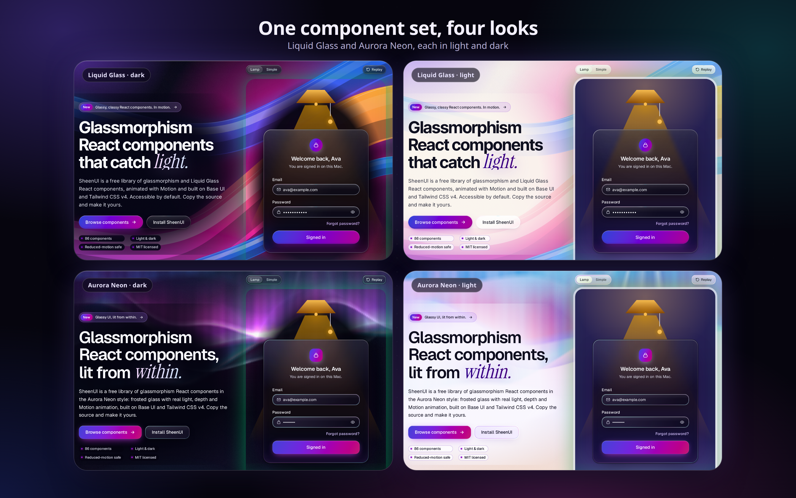</a></p>

<p align="center"><a href="https://lokendra-builds.github.io/sheenui/components/data-table">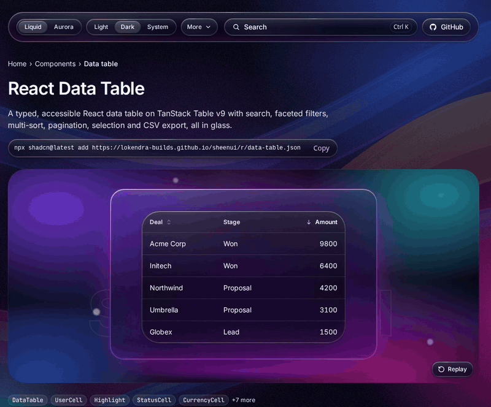</a></p>

## Components

Payment flows, OTP, chat, pricing and forms, each one a live, keyboard-reachable component with its own docs page.

<p align="center"><a href="https://lokendra-builds.github.io/sheenui/components">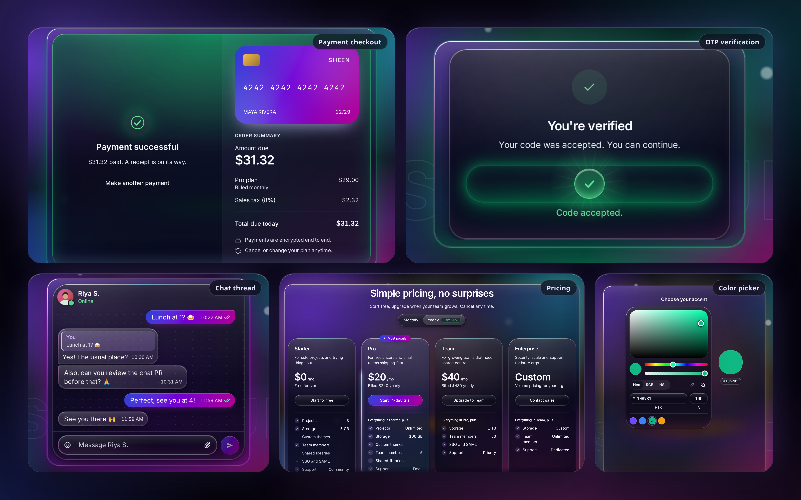</a></p>

<p align="center"><a href="https://lokendra-builds.github.io/sheenui/blocks/otp-verification">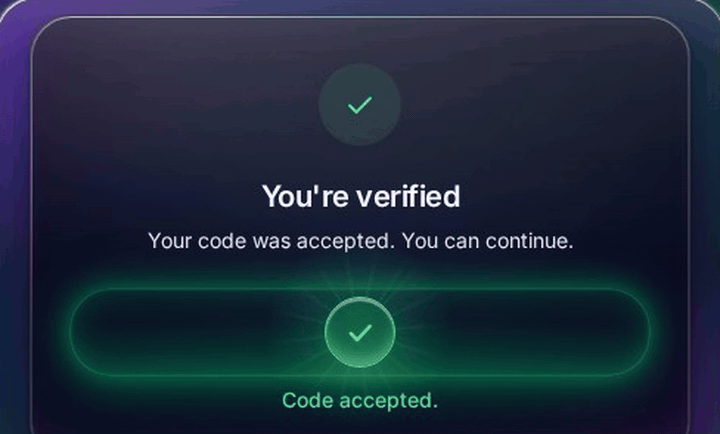</a></p>

## Charts

<!--n:charts-->48<!--/n--> animated charts with a glass tooltip, keyboard reading, a color-blind-safe palette and a table view of the same data.

<p align="center"><a href="https://lokendra-builds.github.io/sheenui/charts">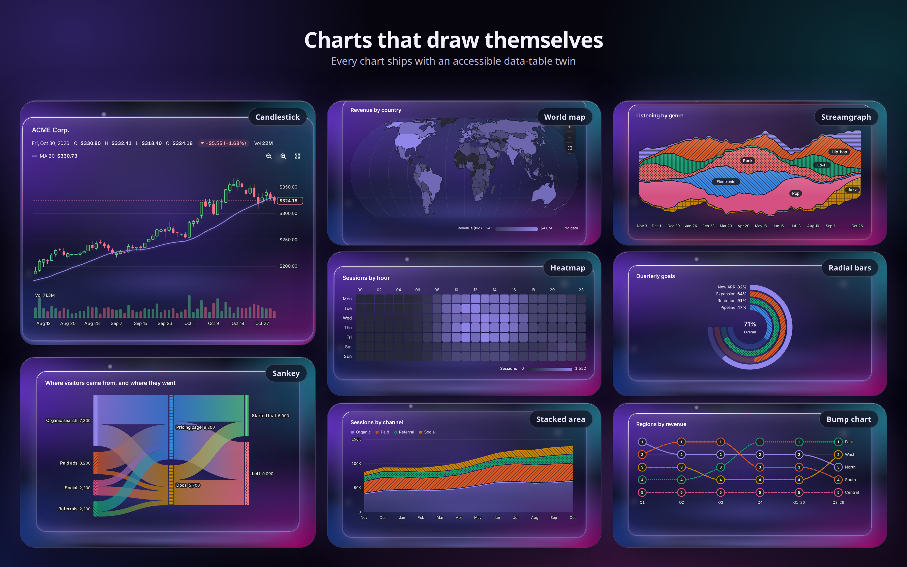</a></p>

## Dashboards

<!--n:dashboards-->5<!--/n--> dashboard templates on one shared kit, responsive down to a phone. They take a `load` function, so production never shows fake numbers.

<p align="center"><a href="https://lokendra-builds.github.io/sheenui/dashboards">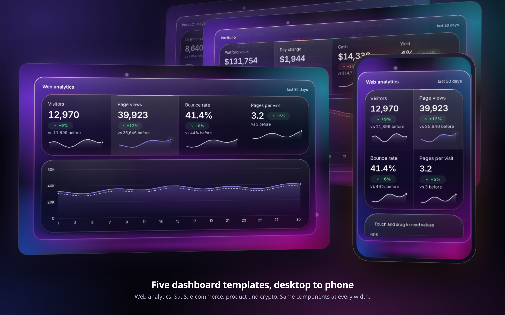</a></p>

## Blocks and effects

<!--n:blocks-->20<!--/n--> ready-made sections, and <!--n:effects-->19<!--/n--> effects such as beams, particles, meteors and orbits that pause off-screen.

<p align="center"><a href="https://lokendra-builds.github.io/sheenui/blocks">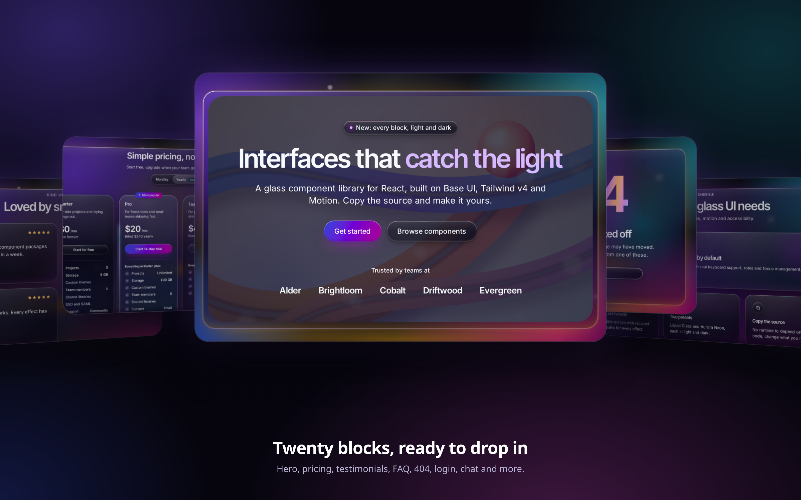</a></p>

<p align="center"><a href="https://lokendra-builds.github.io/sheenui/effects">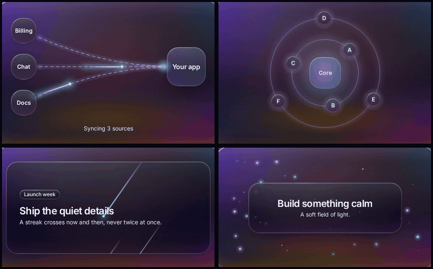</a></p>

<details>
<summary><b>More screenshots</b></summary>

<p align="center">
  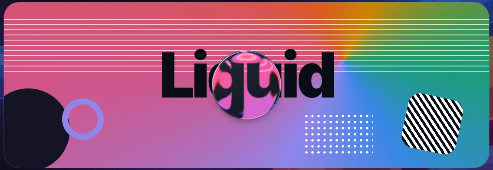<br><sub>The refraction lens bending the pattern behind it (Chromium; other browsers get frosted glass)</sub>
</p>

<table>
  <tr>
    <td width="50%" align="center"><a href="screenshots/chat-thread-aurora-dark.webp">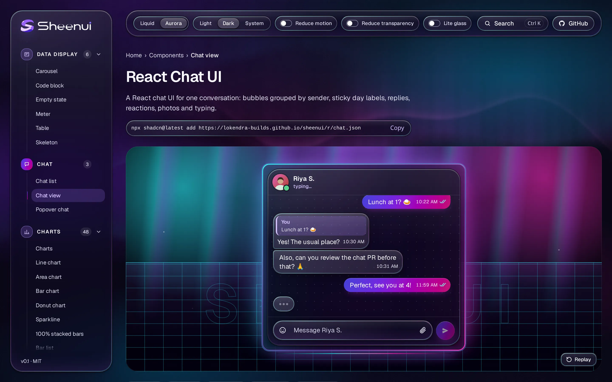</a><br><sub>Chat thread</sub></td>
    <td width="50%" align="center"><a href="screenshots/charts-heatmap-liquid-light.webp">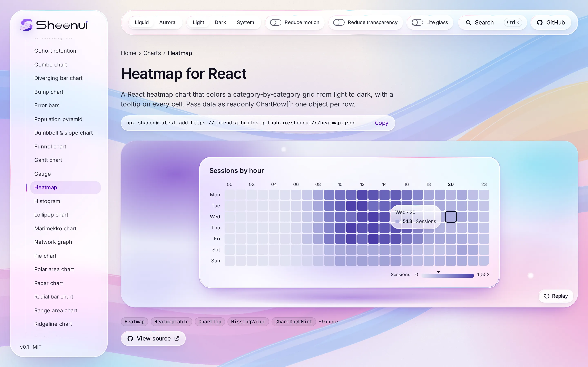</a><br><sub>Heatmap with a glass tooltip</sub></td>
  </tr>
  <tr>
    <td width="50%" align="center"><a href="screenshots/search-liquid-dark.webp">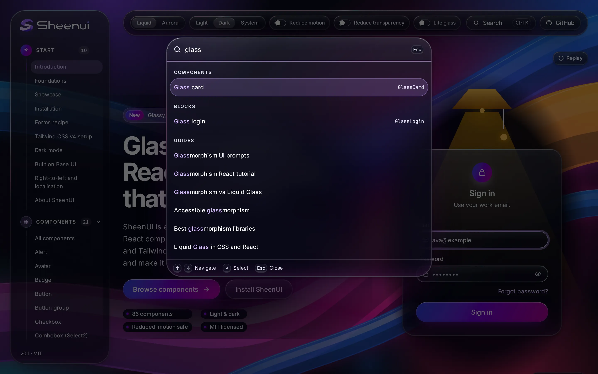</a><br><sub>Search palette</sub></td>
    <td width="50%" align="center"><a href="screenshots/components-liquid-dark.webp">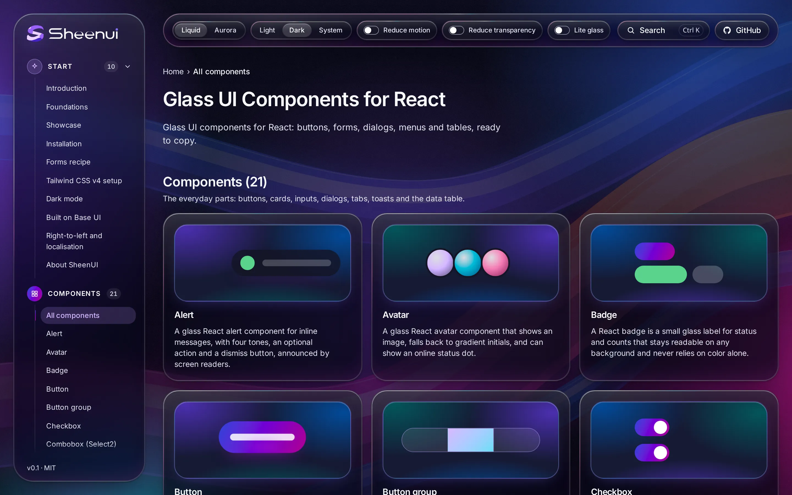</a><br><sub>The components hub</sub></td>
  </tr>
</table>

</details>

## Requirements

SheenUI is **pre-1.0 and not on npm yet** (version 0.1.0); you add its source to your app.

| | |
|---|---|
| **React** | `react` and `react-dom` `^19.2.0` |
| **Tailwind CSS** | `tailwindcss` `^4.1.0`. v4 only: Tailwind v3 is not supported. See the [Tailwind v4 setup](https://lokendra-builds.github.io/sheenui/docs/tailwind-v4) |
| **Base UI and Motion** | `@base-ui/react` `^1.9.0`, `motion` `^14.10.1` |
| **TypeScript types** | `@types/react` `^19` (optional peer) |
| **Brought along** | `clsx` `^2.1.1`, `tailwind-merge` `^3.7.0`; `@tanstack/react-table` `^9.3.1` for the Data Table only |
| **Adding components** | `npx shadcn@latest add <url>` or `pnpm dlx shadcn@latest add <url>` (the two forms the guides use). The shadcn CLI 4.23 needs Node.js 20.18.1 or newer, and Vite 8, which the registry check builds with, needs Node.js 20.19 or newer (or 22.12+) |
| **Frameworks** | Vite and Next.js (App Router). Every registry item is installed with the shadcn CLI and built in both by [`pnpm registry:check --all --frameworks vite,next`](https://lokendra-builds.github.io/sheenui/guides/install-frameworks). In Next.js the theme CSS import must be a relative path. `pnpm verify` runs only the fast registry check, without installs |
| **Browsers** | Latest two versions of Chrome, Edge, Firefox and Safari. Real glass needs `backdrop-filter`; refraction runs in Chromium only; elsewhere, or when the user asks for less transparency, glass becomes a solid or frosted surface |
| **Working on this repo** | Node.js 24 (`.nvmrc`: 24.18.0) and pnpm 11 (`packageManager`: pnpm@11.0.4; run `corepack enable`). Use pnpm, not npm, in this repo: npm ignores the `publishConfig` that points the package exports at `dist/`. TypeScript strict (7.0.2 in the library and the docs site; the root tooling pins 6.0.3) |

## Quick start

You need React 19.2 or newer and Tailwind CSS v4 (Vite, Next.js or any bundler Tailwind v4 supports). Steps for Next.js (App Router) and Vite are in the [installation guide](https://lokendra-builds.github.io/sheenui/docs/installation).

**1. Add a component.** The CLI also pulls in `sheenui-theme` (tokens, glass, motion, hooks, styles) and the npm packages it needs. Step 3 uses the backdrop and the toast provider, so add them in the same command:

```bash
npx shadcn@latest add \
  https://lokendra-builds.github.io/sheenui/r/button.json \
  https://lokendra-builds.github.io/sheenui/r/backdrop.json \
  https://lokendra-builds.github.io/sheenui/r/toast.json
```

Swap `button` for any folder name: `dialog`, `tabs`, `data-table`, `line-chart`, `chat`, `glass-login`, `analytics-saas` and so on (the full list is in [`registry.json`](registry.json)).

> **If that URL answers 404** (the docs site is not deployed yet, or you run a fork), serve the registry from a clone instead and use `http://127.0.0.1:4410/r/<name>.json` in the command above:
>
> ```bash
> node scripts/build-registry.mjs --base http://127.0.0.1:4410/r --out /tmp/sheenui-registry/r --no-root --quiet
> cd /tmp/sheenui-registry && python3 -m http.server 4410 --bind 127.0.0.1
> ```

**2. Check the CSS import.** The CLI adds `@import "@/components/sheenui/styles/index.css";`. It must come **after** `@import "tailwindcss";`. In Next.js, change it to a relative path (`@import "../components/sheenui/styles/index.css";`): Next.js cannot resolve `@/` inside CSS. Vite resolves the alias, so leave it.

**3. Wrap your app once.** A CLI install copies the files into `components/sheenui/<folder>/`; there is no barrel file, so import each piece from its own file:

```tsx
import { SheenMotionProvider } from "@/components/sheenui/motion/provider";
import { SheenBackdrop } from "@/components/sheenui/backdrop/backdrop";
import { ToastProvider, Toaster } from "@/components/sheenui/toast/toast";

<SheenMotionProvider>
  <ToastProvider>
    <SheenBackdrop />
    <App />
    <Toaster />
  </ToastProvider>
</SheenMotionProvider>
```

**4. Apply saved preferences before first paint.** Inline `sheenPreferenceScript` (from `@/components/sheenui/hooks/use-preferences`) in `<head>` so style, theme and motion choices do not flash.

**5. Use a component.**

```tsx
import { Button } from "@/components/sheenui/button/button";

export function Hello() {
  return <Button>Hello, glass</Button>;
}
```

Docs pages write imports as `@sheenui/theme` (the package barrel). After a CLI install, use the copied path instead, for example `import { Dialog } from "@/components/sheenui/dialog/dialog"`. Each docs page has a "Copied files" tab with the exact import lines.

<details>
<summary><b>Copy the files instead of using the CLI</b></summary>

1. Install the packages the theme uses:
   ```bash
   pnpm add @base-ui/react motion clsx tailwind-merge
   # only for the Data Table:
   pnpm add @tanstack/react-table
   ```
2. Copy these folders from [`theme/src/`](theme/src) into your app, for example into `src/sheen/`:
   `styles/`, `lib/`, `motion/`, `hooks/`, and the component folders you want (`components/button/`, `components/dialog/`, ...).
   **Files to copy:** every docs page has a box that lists the exact files and packages that component needs, computed from the real import graph. `pnpm copy-test` proves each one builds in an empty Vite + Tailwind app.
3. Import the styles after Tailwind, and tell Tailwind to scan the copied files (adjust the paths to where you put them):
   ```css
   @import "tailwindcss";
   @import "./sheen/styles/index.css";
   @source "./sheen";
   ```
4. Wrap your app once (step 3 above), then use a component:
   ```tsx
   import { Button } from "@sheenui/theme";

   export function Hello() {
     return <Button>Hello, glass</Button>;
   }
   ```

</details>

<details>
<summary><b>Install the package from a tarball</b></summary>

The package ships compiled ES modules, type declarations and one stylesheet. Pack it from a clone, then install the file (use pnpm: `npm publish` and `npm pack` would ignore the `publishConfig` that points `exports` at `dist/`):

```bash
git clone https://github.com/lokendra-builds/sheenui && cd sheenui
pnpm install
pnpm --filter @sheenui/theme pack --pack-destination ..    # builds dist/ and writes ../sheenui-theme-0.1.0.tgz
cd ../my-app && pnpm add ../sheenui-theme-0.1.0.tgz motion @base-ui/react
# Tailwind CSS v4 with its Vite plugin, if the app does not have it yet:
pnpm add -D tailwindcss @tailwindcss/vite
```

```css
@import "tailwindcss";
@import "@sheenui/theme/styles.css";
```

`styles.css` already tells Tailwind to scan the package, so no `@source` line is needed. The package marks only CSS as having side effects, so a bundle that imports `Button` carries no charts, chat or Motion engine.

</details>

## What is inside

| Part | What it covers |
|---|---|
| **[Components](https://lokendra-builds.github.io/sheenui/components)** | <!--n:components-->86<!--/n--> pages (<!--n:componentsHub-->67<!--/n--> components plus <!--n:effects-->19<!--/n--> effects): buttons, forms, overlays, navigation, layout, data display, chat. Each has a live demo, props, keyboard notes and the files to copy |
| **[Charts](https://lokendra-builds.github.io/sheenui/charts)** | <!--n:charts-->48<!--/n--> animated charts from line and bar to Sankey, heatmap and world map. Every chart has a glass tooltip, keyboard reading, a table view of the same data and a color-blind-safe palette |
| **[Blocks](https://lokendra-builds.github.io/sheenui/blocks)** | <!--n:blocks-->20<!--/n--> sections: sign-in, split-screen auth, OTP, checkout, pricing, bento grid, notification center, settings, AI chat, chat app, hero, features, testimonials, FAQ, contact form, footer, 404, announcement banner |
| **[Dashboards](https://lokendra-builds.github.io/sheenui/dashboards)** | <!--n:dashboards-->5<!--/n--> templates (web analytics, SaaS revenue, e-commerce, product analytics, finance) on one shared `analytics-kit`. They take a `load` function, so production never shows fake numbers |
| **[Guides](https://lokendra-builds.github.io/sheenui/guides)** | <!--n:guides-->13<!--/n--> tutorials and comparisons: accessible glassmorphism, Liquid Glass in CSS, `backdrop-filter` performance |
| **Registry** | <!--n:registry-->183<!--/n--> shadcn registry items (<!--n:registryUi-->149<!--/n--> components and charts, <!--n:registryBlocks-->33<!--/n--> blocks and block parts, plus the shared `sheenui-theme`), and `llms.txt` for AI assistants |

<details>
<summary><b>All components by group (generated from the routes)</b></summary>

Every name links to its docs page. The two tables below are generated by `pnpm readme:index`.

<!-- components-index:start -->
| Group | Components |
|---|---|
| **Start** (10)<br>Install, setup, theory and the forms recipe | [About SheenUI](https://lokendra-builds.github.io/sheenui/about) · [Built on Base UI](https://lokendra-builds.github.io/sheenui/docs/base-ui) · [Dark mode](https://lokendra-builds.github.io/sheenui/docs/dark-mode) · [Forms recipe](https://lokendra-builds.github.io/sheenui/docs/forms) · [Foundations](https://lokendra-builds.github.io/sheenui/foundations) · [Installation](https://lokendra-builds.github.io/sheenui/docs/installation) · [Introduction](https://lokendra-builds.github.io/sheenui/) · [Right-to-left and localisation](https://lokendra-builds.github.io/sheenui/docs/rtl) · [Showcase](https://lokendra-builds.github.io/sheenui/showcase) · [Tailwind CSS v4 setup](https://lokendra-builds.github.io/sheenui/docs/tailwind-v4) |
| **Components** (21)<br>Core controls and display | [Alert](https://lokendra-builds.github.io/sheenui/components/alert) · [All components](https://lokendra-builds.github.io/sheenui/components) · [Avatar](https://lokendra-builds.github.io/sheenui/components/avatar) · [Badge](https://lokendra-builds.github.io/sheenui/components/badge) · [Button](https://lokendra-builds.github.io/sheenui/components/button) · [Button group](https://lokendra-builds.github.io/sheenui/components/button-group) · [Checkbox](https://lokendra-builds.github.io/sheenui/components/checkbox) · [Combobox (Select2)](https://lokendra-builds.github.io/sheenui/components/combobox) · [Data table](https://lokendra-builds.github.io/sheenui/components/data-table) · [Dialog](https://lokendra-builds.github.io/sheenui/components/dialog) · [Glass card](https://lokendra-builds.github.io/sheenui/components/glass-card) · [Input](https://lokendra-builds.github.io/sheenui/components/input) · [OTP input](https://lokendra-builds.github.io/sheenui/components/otp-input) · [Popover](https://lokendra-builds.github.io/sheenui/components/popover) · [Progress](https://lokendra-builds.github.io/sheenui/components/progress) · [Select](https://lokendra-builds.github.io/sheenui/components/select) · [Slider](https://lokendra-builds.github.io/sheenui/components/slider) · [Spinner](https://lokendra-builds.github.io/sheenui/components/spinner) · [Switch](https://lokendra-builds.github.io/sheenui/components/switch) · [Tabs](https://lokendra-builds.github.io/sheenui/components/tabs) · [Toast](https://lokendra-builds.github.io/sheenui/components/toast) · [Tooltip](https://lokendra-builds.github.io/sheenui/components/tooltip) |
| **Forms** (13)<br>Inputs, pickers, upload | [Calendar](https://lokendra-builds.github.io/sheenui/forms/calendar) · [Color picker](https://lokendra-builds.github.io/sheenui/forms/color-picker) · [Date picker](https://lokendra-builds.github.io/sheenui/forms/date-picker) · [Field and Label](https://lokendra-builds.github.io/sheenui/forms/field) · [File upload](https://lokendra-builds.github.io/sheenui/forms/file-upload) · [Input group](https://lokendra-builds.github.io/sheenui/forms/input-group) · [Number field](https://lokendra-builds.github.io/sheenui/forms/number-field) · [Radio group](https://lokendra-builds.github.io/sheenui/forms/radio-group) · [Rating](https://lokendra-builds.github.io/sheenui/forms/rating) · [Segmented control](https://lokendra-builds.github.io/sheenui/forms/segmented-control) · [Tags input](https://lokendra-builds.github.io/sheenui/forms/tags-input) · [Textarea](https://lokendra-builds.github.io/sheenui/forms/textarea) · [Toggle](https://lokendra-builds.github.io/sheenui/forms/toggle) |
| **Overlays** (9)<br>Dialogs, menus, drawers, palettes | [Alert dialog](https://lokendra-builds.github.io/sheenui/overlays/alert-dialog) · [Command palette (⌘K)](https://lokendra-builds.github.io/sheenui/overlays/command-palette) · [Context menu](https://lokendra-builds.github.io/sheenui/overlays/context-menu) · [Drawer / Sheet](https://lokendra-builds.github.io/sheenui/overlays/drawer) · [Dropdown menu](https://lokendra-builds.github.io/sheenui/overlays/dropdown-menu) · [Hover card](https://lokendra-builds.github.io/sheenui/overlays/hover-card) · [Kbd](https://lokendra-builds.github.io/sheenui/overlays/kbd) · [Menubar](https://lokendra-builds.github.io/sheenui/overlays/menubar) · [Side drawer](https://lokendra-builds.github.io/sheenui/overlays/side-drawer) |
| **Navigation** (4)<br>Navbars and sidebars | [Navbar](https://lokendra-builds.github.io/sheenui/navigation/navbar) · [Navigation menu](https://lokendra-builds.github.io/sheenui/navigation/navigation-menu) · [Sidebar](https://lokendra-builds.github.io/sheenui/navigation/sidebar) · [Vertical nav](https://lokendra-builds.github.io/sheenui/navigation/vertical-nav) |
| **Layout** (11)<br>Structure and flow | [Accordion](https://lokendra-builds.github.io/sheenui/layout/accordion) · [Aspect ratio](https://lokendra-builds.github.io/sheenui/layout/aspect-ratio) · [Breadcrumb](https://lokendra-builds.github.io/sheenui/layout/breadcrumb) · [Collapsible](https://lokendra-builds.github.io/sheenui/layout/collapsible) · [Pagination](https://lokendra-builds.github.io/sheenui/layout/pagination) · [Resizable panels](https://lokendra-builds.github.io/sheenui/layout/resizable) · [Scroll area](https://lokendra-builds.github.io/sheenui/layout/scroll-area) · [Separator](https://lokendra-builds.github.io/sheenui/layout/separator) · [Stepper](https://lokendra-builds.github.io/sheenui/layout/stepper) · [Timeline](https://lokendra-builds.github.io/sheenui/layout/timeline) · [Toolbar](https://lokendra-builds.github.io/sheenui/layout/toolbar) |
| **Data display** (6)<br>Content and feedback | [Carousel](https://lokendra-builds.github.io/sheenui/components/carousel) · [Code block](https://lokendra-builds.github.io/sheenui/components/code-block) · [Empty state](https://lokendra-builds.github.io/sheenui/components/empty-state) · [Meter](https://lokendra-builds.github.io/sheenui/components/meter) · [Skeleton](https://lokendra-builds.github.io/sheenui/components/skeleton) · [Table](https://lokendra-builds.github.io/sheenui/components/table) |
| **Chat** (3)<br>Messaging UI | [Chat list](https://lokendra-builds.github.io/sheenui/chat/list) · [Chat view](https://lokendra-builds.github.io/sheenui/chat/thread) · [Popover chat](https://lokendra-builds.github.io/sheenui/chat/widget) |
| **Effects** (19)<br>Motion and Liquid Glass | [3D tilt card](https://lokendra-builds.github.io/sheenui/effects/3d-tilt-card) · [All effects](https://lokendra-builds.github.io/sheenui/effects) · [Animated beam](https://lokendra-builds.github.io/sheenui/effects/animated-beam) · [Blur in](https://lokendra-builds.github.io/sheenui/effects/blur-in) · [Border beam](https://lokendra-builds.github.io/sheenui/effects/border-beam) · [Confetti](https://lokendra-builds.github.io/sheenui/effects/confetti) · [Liquid glass](https://lokendra-builds.github.io/sheenui/effects/liquid-glass) · [macOS dock](https://lokendra-builds.github.io/sheenui/effects/macos-dock) · [Marquee](https://lokendra-builds.github.io/sheenui/effects/marquee) · [Meteors](https://lokendra-builds.github.io/sheenui/effects/meteors) · [Morphing dialog](https://lokendra-builds.github.io/sheenui/effects/morphing-dialog) · [Number ticker](https://lokendra-builds.github.io/sheenui/effects/number-ticker) · [Orbiting circles](https://lokendra-builds.github.io/sheenui/effects/orbiting-circles) · [Particles](https://lokendra-builds.github.io/sheenui/effects/particles) · [Scroll progress](https://lokendra-builds.github.io/sheenui/effects/scroll-progress) · [Shimmer text](https://lokendra-builds.github.io/sheenui/effects/shimmer-text) · [Spotlight card](https://lokendra-builds.github.io/sheenui/effects/spotlight-card) · [Text reveal](https://lokendra-builds.github.io/sheenui/effects/text-reveal) · [Typewriter](https://lokendra-builds.github.io/sheenui/effects/typewriter) · [Word rotate](https://lokendra-builds.github.io/sheenui/effects/word-rotate) |
| **Blocks** (21)<br>Ready-made sections | [All blocks](https://lokendra-builds.github.io/sheenui/blocks) · [Glass login](https://lokendra-builds.github.io/sheenui/blocks/glass-login) · [Lamp login](https://lokendra-builds.github.io/sheenui/blocks/lamp-login) · [OTP verification](https://lokendra-builds.github.io/sheenui/blocks/otp-verification) · [Payment checkout](https://lokendra-builds.github.io/sheenui/blocks/payment-checkout) · [Dashboard stats](https://lokendra-builds.github.io/sheenui/blocks/dashboard-stats) · [AI chat](https://lokendra-builds.github.io/sheenui/blocks/ai-chat) · [Sign-up page](https://lokendra-builds.github.io/sheenui/blocks/signup-page) · [Bento grid](https://lokendra-builds.github.io/sheenui/blocks/bento-grid) · [Chat app](https://lokendra-builds.github.io/sheenui/blocks/chat-app) · [Notification center](https://lokendra-builds.github.io/sheenui/blocks/notification-center) · [Pricing](https://lokendra-builds.github.io/sheenui/blocks/pricing) · [Settings page](https://lokendra-builds.github.io/sheenui/blocks/settings-page) · [Hero section](https://lokendra-builds.github.io/sheenui/blocks/hero-section) · [Feature grid](https://lokendra-builds.github.io/sheenui/blocks/feature-grid) · [Testimonials](https://lokendra-builds.github.io/sheenui/blocks/testimonials) · [FAQ section](https://lokendra-builds.github.io/sheenui/blocks/faq-section) · [Contact form](https://lokendra-builds.github.io/sheenui/blocks/contact-form) · [Site footer](https://lokendra-builds.github.io/sheenui/blocks/site-footer) · [404 page](https://lokendra-builds.github.io/sheenui/blocks/not-found-page) · [Announcement banner](https://lokendra-builds.github.io/sheenui/blocks/announcement-banner) |
| **Dashboards** (6)<br>Analytics templates | [All dashboards](https://lokendra-builds.github.io/sheenui/dashboards) · [Web analytics](https://lokendra-builds.github.io/sheenui/dashboards/web-analytics) · [SaaS revenue](https://lokendra-builds.github.io/sheenui/dashboards/saas) · [E-commerce](https://lokendra-builds.github.io/sheenui/dashboards/ecommerce) · [Product analytics](https://lokendra-builds.github.io/sheenui/dashboards/product) · [Crypto dashboard](https://lokendra-builds.github.io/sheenui/dashboards/crypto-dashboard) |
| **Guides** (13)<br>Tutorials, comparisons and install steps (the hub page comes first) | [Guides](https://lokendra-builds.github.io/sheenui/guides) · [Install in Next.js and Vite](https://lokendra-builds.github.io/sheenui/guides/install-frameworks) · [Glassmorphism React tutorial](https://lokendra-builds.github.io/sheenui/guides/glassmorphism-react-tutorial) · [Liquid Glass in CSS and React](https://lokendra-builds.github.io/sheenui/guides/liquid-glass-css-react) · [Accessible glassmorphism](https://lokendra-builds.github.io/sheenui/guides/accessible-glassmorphism) · [Glassmorphism vs Liquid Glass](https://lokendra-builds.github.io/sheenui/guides/glassmorphism-vs-liquid-glass) · [backdrop-filter performance](https://lokendra-builds.github.io/sheenui/guides/backdrop-filter-performance) · [Accessible React charts](https://lokendra-builds.github.io/sheenui/guides/accessible-react-charts) · [Framer Motion examples](https://lokendra-builds.github.io/sheenui/guides/framer-motion-examples) · [Framer Motion to Motion](https://lokendra-builds.github.io/sheenui/guides/framer-motion-to-motion) · [Base UI vs Radix](https://lokendra-builds.github.io/sheenui/guides/base-ui-vs-radix) · [Best glassmorphism libraries](https://lokendra-builds.github.io/sheenui/guides/best-glassmorphism-react-libraries) · [shadcn alternatives](https://lokendra-builds.github.io/sheenui/guides/shadcn-alternatives) · [Glassmorphism UI prompts](https://lokendra-builds.github.io/sheenui/guides/glassmorphism-ui-prompt) |
<!-- components-index:end -->

</details>

<details>
<summary><b>All chart pages by category</b></summary>

<!-- chart-index:start -->
| Category | Chart pages |
|---|---|
| **Core charts** (5) | [Line chart](https://lokendra-builds.github.io/sheenui/charts/line-chart) · [Area chart](https://lokendra-builds.github.io/sheenui/charts/area-chart) · [Bar chart](https://lokendra-builds.github.io/sheenui/charts/bar-chart) · [Donut chart](https://lokendra-builds.github.io/sheenui/charts/donut-chart) · [Sparkline](https://lokendra-builds.github.io/sheenui/charts/sparkline) |
| **Trends and time** (10) | [Bump chart](https://lokendra-builds.github.io/sheenui/charts/bump-chart) · [Combo chart](https://lokendra-builds.github.io/sheenui/charts/combo-chart) · [Stacked area chart](https://lokendra-builds.github.io/sheenui/charts/stacked-area-chart) · [Step line chart](https://lokendra-builds.github.io/sheenui/charts/step-line-chart) · [Range area chart](https://lokendra-builds.github.io/sheenui/charts/range-area-chart) · [Streamgraph](https://lokendra-builds.github.io/sheenui/charts/streamgraph) · [Real-time chart](https://lokendra-builds.github.io/sheenui/charts/realtime-chart) · [Candlestick chart](https://lokendra-builds.github.io/sheenui/charts/candlestick) · [Calendar heatmap](https://lokendra-builds.github.io/sheenui/charts/calendar-heatmap) · [Gantt chart](https://lokendra-builds.github.io/sheenui/charts/gantt) |
| **Comparison** (11) | [100% stacked bars](https://lokendra-builds.github.io/sheenui/charts/percent-stacked-bar-chart) · [Bar list](https://lokendra-builds.github.io/sheenui/charts/bar-list) · [Category bar](https://lokendra-builds.github.io/sheenui/charts/category-bar) · [Diverging bar chart](https://lokendra-builds.github.io/sheenui/charts/diverging-bar) · [Dumbbell & slope chart](https://lokendra-builds.github.io/sheenui/charts/dumbbell) · [Lollipop chart](https://lokendra-builds.github.io/sheenui/charts/lollipop) · [Population pyramid](https://lokendra-builds.github.io/sheenui/charts/population-pyramid) · [Radar chart](https://lokendra-builds.github.io/sheenui/charts/radar-chart) · [Polar area chart](https://lokendra-builds.github.io/sheenui/charts/polar-area) · [Radial bar chart](https://lokendra-builds.github.io/sheenui/charts/radial-bar-chart) · [Waterfall chart](https://lokendra-builds.github.io/sheenui/charts/waterfall-chart) |
| **Distribution and correlation** (7) | [Histogram](https://lokendra-builds.github.io/sheenui/charts/histogram) · [Box plot & violin](https://lokendra-builds.github.io/sheenui/charts/box-plot) · [Error bars](https://lokendra-builds.github.io/sheenui/charts/error-bar-chart) · [Beeswarm](https://lokendra-builds.github.io/sheenui/charts/beeswarm) · [Scatter & bubble chart](https://lokendra-builds.github.io/sheenui/charts/scatter-plot) · [Ridgeline chart](https://lokendra-builds.github.io/sheenui/charts/ridgeline) · [Heatmap](https://lokendra-builds.github.io/sheenui/charts/heatmap) |
| **Parts of a whole** (5) | [Pie chart](https://lokendra-builds.github.io/sheenui/charts/pie-chart) · [Treemap](https://lokendra-builds.github.io/sheenui/charts/treemap) · [Sunburst chart](https://lokendra-builds.github.io/sheenui/charts/sunburst) · [Waffle chart](https://lokendra-builds.github.io/sheenui/charts/waffle) · [Marimekko chart](https://lokendra-builds.github.io/sheenui/charts/marimekko) |
| **Flow and funnels** (5) | [Sankey diagram](https://lokendra-builds.github.io/sheenui/charts/sankey-diagram) · [Chord diagram](https://lokendra-builds.github.io/sheenui/charts/chord-diagram) · [Network graph](https://lokendra-builds.github.io/sheenui/charts/network-graph) · [Funnel chart](https://lokendra-builds.github.io/sheenui/charts/funnel-chart) · [Cohort retention](https://lokendra-builds.github.io/sheenui/charts/cohort-retention) |
| **KPIs and status** (4) | [Gauge](https://lokendra-builds.github.io/sheenui/charts/gauge-chart) · [Bullet chart](https://lokendra-builds.github.io/sheenui/charts/bullet-chart) · [Sparkbar](https://lokendra-builds.github.io/sheenui/charts/sparkbar) · [Uptime tracker](https://lokendra-builds.github.io/sheenui/charts/uptime-tracker) |
| **Maps** (1) | [World map](https://lokendra-builds.github.io/sheenui/charts/world-map) |
<!-- chart-index:end -->

</details>

## What the repo proves

These are claims with a check behind each one, not goals.

**Accessibility**

- Every component test renders light and dark in both style presets and runs axe-core (<!--n:testFiles-->141<!--/n--> test files, in a real Chromium).
- A Python script measures text contrast from rendered pixels on 20 routes in all four looks (axe cannot see through `backdrop-filter`). Text tokens stay at 4.5:1 or more on the page and on glass; control edges and focus rings at 3:1 or more.
- Honours `prefers-reduced-motion`, `prefers-reduced-transparency`, `prefers-contrast: more` and Windows forced colors, each also available as an in-app toggle.
- Focus, keyboard and ARIA come from Base UI primitives. Touch targets grow to 44 px on coarse pointers. Layouts mirror in right-to-left.

**Motion**

- Animates `transform` and `opacity` only (`pnpm motion:properties`). A lint check fails the build on hard-coded easing curves and durations outside the token files (`pnpm motion:literals`).
- Exits are shorter than entrances and never overshoot. Loops pause off-screen and in hidden tabs.

**Code quality**

- TypeScript strict, ESLint with zero warnings allowed, Prettier, and a doc comment on every export (see [Built for AI coding agents](#built-for-ai-coding-agents)).
- Unit tests run in a real Chromium with coverage gates: at least 90 % of lines, functions and statements, 80 % of branches, and a floor per file. Playwright end-to-end specs cover every route, visual baselines, accessibility and the motion gates.
- `pnpm package:check` builds and packs the package and checks every export target; `pnpm treeshake:check` checks that importing only `Button` pulls in none of the heavy modules.

**Performance**

- A JavaScript budget per docs-site route, which `pnpm budget` enforces (gzip, initial load): 135 KB for the home page, 190 KB for plain docs pages, 210 KB for pages with a live example and 250 KB for chart pages.
- Glass is designed to a blur budget: at most 8 `backdrop-filter` surfaces in view and at most 3 refraction lenses. The home page currently exceeds it at 1440 px (see Known limits).
- Lite glass switches on by itself on weak devices (low memory, few cores, Save-Data, or a low measured frame rate).

## Compared with shadcn/ui-style libraries

SheenUI uses the same delivery model as [shadcn/ui](https://ui.shadcn.com): source in your repo, a registry, no runtime dependency on the library. The difference is the subject.

| | shadcn/ui and similar | SheenUI |
|---|---|---|
| **Look** | Flat, neutral, themeable | Glass, light and rim effects, two presets |
| **Glass handling** | Not a goal | Contrast tokens, solid fallbacks, blur budget, Lite mode |
| **Motion** | Add your own | Springs and reduced-motion paths built in |
| **Charts, dashboards** | Charts on Recharts | <!--n:charts-->48<!--/n--> own charts with table twins, <!--n:dashboards-->5<!--/n--> dashboard templates |
| **Maturity and ecosystem** | Large, widely adopted, many community add-ons | Pre-1.0, one maintainer, not on npm yet |
| **Browser reach** | Everywhere | Refraction is Chromium-only; frosted glass elsewhere |

If you want a quiet, flat interface, shadcn/ui is the better fit. If glass is the design, SheenUI does the hard parts for you. Read the [full comparison](https://lokendra-builds.github.io/sheenui/guides/shadcn-alternatives).

## Known limits

- **No real phone has been tested.** Android is covered by Chromium touch emulation, iOS by WebKit with an iPhone profile. iOS Safari blur is unverified.
- **Liquid Glass refraction is Chromium-only.** Everywhere else `<LiquidGlass>` is frosted glass.
- **Not on npm.** `@sheenui/theme` is `private` in the repo for now.
- **Performance gaps.** The home page shows more blurred surfaces than the budget at 1440 px, and a few heavy pages have a long task between 50 and 65 ms.

## Docs

| Where | What |
|---|---|
| [Live docs site](https://lokendra-builds.github.io/sheenui/) | Every component with a live preview, props table, keyboard notes and the "Files to copy" box |
| [`llms.txt`](https://lokendra-builds.github.io/sheenui/llms.txt) | Facts and a page index for AI assistants; every page also exists as Markdown (add `.md`) |
| [Foundations](https://lokendra-builds.github.io/sheenui/foundations) | Tokens, glass and motion |
| [Accessible glassmorphism](https://lokendra-builds.github.io/sheenui/guides/accessible-glassmorphism) | Contrast, reduced transparency, forced colors |
| [Liquid Glass in CSS and React](https://lokendra-builds.github.io/sheenui/guides/liquid-glass-css-react) | How the refraction lens works |
| [backdrop-filter performance](https://lokendra-builds.github.io/sheenui/guides/backdrop-filter-performance) | Why blur is expensive and how to budget it |
| [`theme/`](theme) and [`demo/`](demo) | The library source and the docs site source |

**Run the demo locally.** You need Node.js 24 and [pnpm](https://pnpm.io) 11.

```bash
git clone https://github.com/lokendra-builds/sheenui.git
cd sheenui
pnpm install
pnpm dev          # http://localhost:5173/sheenui/
```

## License and credits

[MIT](LICENSE) © Lokendra Singh Rathore. Built on [Base UI](https://base-ui.com), [Motion](https://motion.dev) and [Tailwind CSS](https://tailwindcss.com); the registry format follows [shadcn/ui](https://ui.shadcn.com). Third-party licences are in [`THIRD_PARTY_NOTICES.md`](THIRD_PARTY_NOTICES.md).

---

<div align="center">

<p>If SheenUI is useful to you, a star on the repo helps other developers find it.</p>

<p>Made in India by <a href="https://github.com/lokendra-builds">Lokendra Singh Rathore</a></p>

</div>
