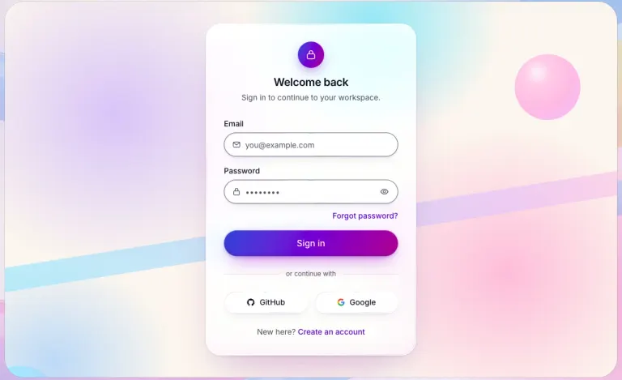

Canonical: https://lokendra-builds.github.io/sheenui/layout/aspect-ratio

# React Aspect Ratio Box for Images & Video

URL: https://lokendra-builds.github.io/sheenui/layout/aspect-ratio
Sidebar name: Aspect ratio

A React aspect ratio component: a box that keeps its width-to-height ratio so images and video reserve space and the page never jumps. Tailwind v4, MIT.

What it is: A React aspect ratio box that keeps images, video and maps at a fixed width-to-height ratio, preventing layout shift. Use AspectRatio to reserve the space of an image, a video poster or a map before it loads, so the page does not jump when the content arrives.

Install:

```bash
npx shadcn@latest add https://lokendra-builds.github.io/sheenui/r/aspect-ratio.json
```

By Lokendra Singh Rathore. Published November 8, 2026, updated November 17, 2026.

Breadcrumb: [Home](https://lokendra-builds.github.io/sheenui/) > [Components](https://lokendra-builds.github.io/sheenui/components/) > Aspect ratio

Files to copy from `theme/src/`:

- `components/aspect-ratio/`
- `lib/cn.ts`
- `styles/`

Packages:

```bash
pnpm add @base-ui/react clsx tailwind-merge
```

Registry item: aspect-ratio. The styles need the [Tailwind v4 glass UI setup](https://lokendra-builds.github.io/sheenui/docs/tailwind-v4).

Import (after `shadcn add` or copying the files, use this today):

```tsx
import { AspectRatio } from "@/components/sheenui/aspect-ratio/aspect-ratio";
import { Button } from "@/components/sheenui/button/button";
```

These examples also use button: `npx shadcn@latest add https://lokendra-builds.github.io/sheenui/r/button.json`

Import from the package (after the first npm release, or a packed tarball):

```tsx
import { AspectRatio, Button } from "@sheenui/theme";
```

## Props

| Prop | Type | Default | Description |
| --- | --- | --- | --- |
| ratio | number | 1 | Width divided by height: 16 / 9, 4 / 3, 1 (default) for a square. |

## Example 1 of 2: Screenshots, a video poster and a profile card

ratio is width divided by height. Images fill the box (size-full object-cover); overlays are positioned inside it. Every tile keeps its ratio at any width, so nothing jumps while images load.

```tsx
import { AspectRatio } from "@/components/sheenui/aspect-ratio/aspect-ratio";
import { Button } from "@/components/sheenui/button/button";
// Package build (after the first npm release, or a packed tarball): import { AspectRatio, Button } from "@sheenui/theme";

export function Example() {
  return (
    <div className="grid w-full gap-4 sm:grid-cols-3">
      <figure className="m-0 flex flex-col gap-2">
        <AspectRatio ratio={16 / 9} className="rounded-sheen-xl border border-sheen-border">
          
        </AspectRatio>
        <figcaption className="text-sm font-medium">Analytics dashboard</figcaption>
      </figure>
      <figure className="m-0 flex flex-col gap-2">
        <AspectRatio ratio={4 / 3} className="rounded-sheen-xl border border-sheen-border">
          
        </AspectRatio>
        <figcaption className="text-sm font-medium">Login form</figcaption>
      </figure>
      <figure className="m-0 flex flex-col gap-2">
        <AspectRatio ratio={21 / 9} className="rounded-sheen-xl border border-sheen-border bg-sheen-accent-soft">
          <div className="absolute inset-0 grid place-items-center">
            <Button size="icon" variant="glass" aria-label="Play the product tour">▶</Button>
          </div>
        </AspectRatio>
        <figcaption className="text-sm font-medium">Product tour</figcaption>
      </figure>
    </div>
  );
}
```

## Example 2 of 2: A figure with a caption

Reserve the space first, then fill it. Put the AspectRatio inside a figure so the caption belongs to it; the box keeps its ratio whatever the width of the figure.

```tsx
import { AspectRatio } from "@/components/sheenui/aspect-ratio/aspect-ratio";
// Package build (after the first npm release, or a packed tarball): import { AspectRatio } from "@sheenui/theme";

export function Example() {
  return (
    <figure className="flex w-64 flex-col gap-2">
      <AspectRatio ratio={4 / 3} render={<div />} className="rounded-sheen-lg bg-gradient-to-br from-violet-400 to-teal-300" />
      <figcaption className="text-sm text-sheen-fg-muted">A 4:3 placeholder: the space is reserved before the image loads.</figcaption>
    </figure>
  );
}
```

## Keyboard

| Keys | Action |
| --- | --- |
| Tab | Not focusable: it is a plain container. Anything focusable inside it keeps its own tab stop. |

## Accessibility

- No role of its own. Give the media inside it text: alt on an image, a title or caption on a video or map.
- It reserves space, which prevents layout shift (CLS) while content loads.
- Pass render to use another element, such as a figure. className and ref go on the box.

## When to use the aspect ratio

- Use AspectRatio for a 16:9 video poster, a square product photo or a map tile in a card grid, so every cell keeps its shape and nothing moves while the images load.
- Pass ratio as width divided by height: 16 / 9 for video, 4 / 3 for photos, 1 for avatars and product tiles. The box keeps that ratio at any width.
- Fill the box with size-full object-cover on the image, and give the box rounded corners: it clips its children.
- Skip it for content whose height should follow its text. A card with copy should size itself, not hold a ratio.
- Pair it with Skeleton as the loading state, with Carousel slides that must share one height, and with figure and figcaption through the render prop.


## Frequently asked questions

### How do I keep an image from shifting the layout while it loads?

Wrap it in AspectRatio with the image's width-to-height ratio. The box takes its height from the ratio right away, so nothing below it moves when the image arrives.

### How do I use another element, such as a figure?

Pass render with the element you want, for example render={<figure />}. The ratio, className and ref still go on that element.

### Does AspectRatio add any accessibility semantics?

No. It is a plain container with no role. Give the media inside it text: alt on an image, a title on a video or map.

### What is the default ratio?

1, a square. Pass 16 / 9, 4 / 3 or any number you need.


## Related pages

- [Avatar](https://lokendra-builds.github.io/sheenui/components/avatar)
- [Skeleton](https://lokendra-builds.github.io/sheenui/components/skeleton)
- [Carousel](https://lokendra-builds.github.io/sheenui/components/carousel)
- [Breadcrumb](https://lokendra-builds.github.io/sheenui/layout/breadcrumb)
- [Collapsible](https://lokendra-builds.github.io/sheenui/layout/collapsible)
- [Pagination](https://lokendra-builds.github.io/sheenui/layout/pagination)

67 components pages in all: browse them on [All components](https://lokendra-builds.github.io/sheenui/components/).


---

Part of SheenUI (https://lokendra-builds.github.io/sheenui/llms.txt). MIT license.
